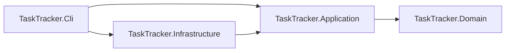

# Архітектура TaskTracker

## Шари

| Шар | Проєкт | Що містить | Що йому заборонено |
|---|---|---|---|
| Домен | TaskTracker.Domain | завдання, колонки, події, таблиця переходів, правило WIP, власні винятки | знати про файли, консоль, JSON та інші шари |
| Прикладний | TaskTracker.Application | сценарії UC-01…UC-06, інтерфейси сховищ, годинника й журналу, барикада вводу, Result | знати про формат зберігання й про консоль |
| Інфраструктура | TaskTracker.Infrastructure | сховище JSON, системний годинник, файловий журнал, генератор умовних даних | містити правила домену |
| Застосунок | TaskTracker.Cli | меню, читання вводу, форматування виводу, композиційний корінь | містити розрахунки й правила |

Тести лежать окремо (`tests/TaskTracker.Tests`) і посилаються на всі три бібліотеки.

## Схема залежностей (рисунок 1)

- Cli → Application: меню викликає сценарії, а не правила.
- Cli → Infrastructure: лише композиційний корінь створює конкретні реалізації.
- Infrastructure → Application: сховище реалізує інтерфейс, оголошений у прикладному шарі.
- Application → Domain: сценарії користуються сутностями й правилами домену.
- До Domain не веде жодна стрілка, і файл проєкту Domain не містить жодного посилання.

## Правило залежностей і як воно закріплене

Залежності спрямовані всередину. Домен не має посилань на інші проєкти, тому компілятор не дозволить використати в ньому щось із Application чи Infrastructure. Додатково `ArchitectureTests` перевіряють, що збірки Domain і Application не посилаються на зайве.
